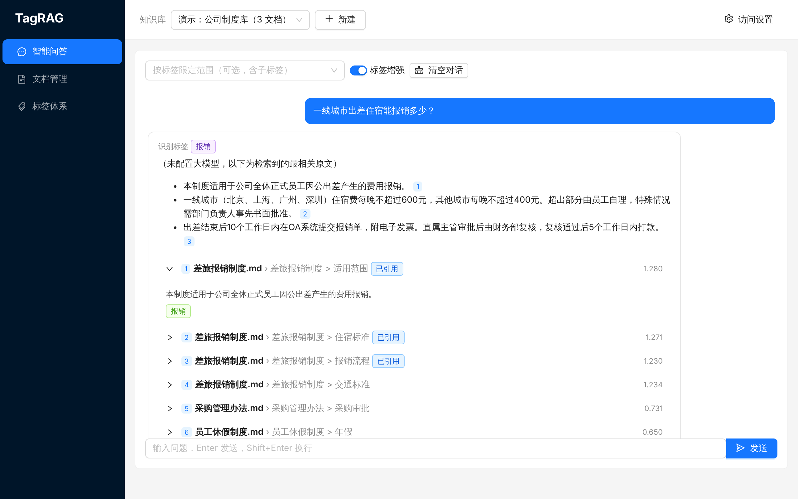
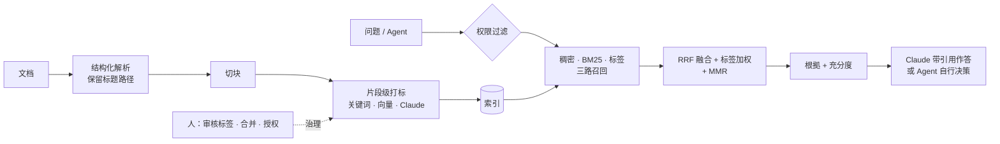
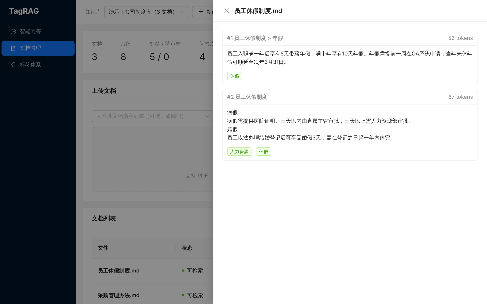
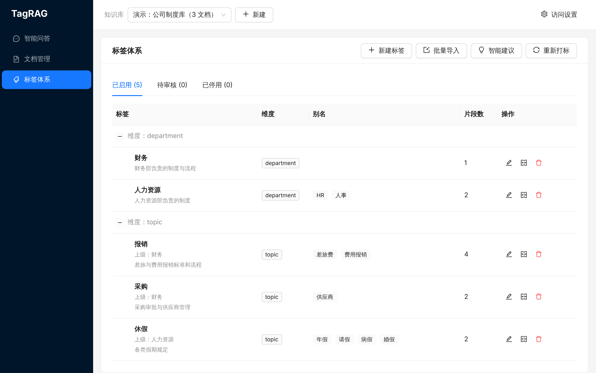

<div align="center">

# TagRAG

**给 AI Agent 的受治理根拠层**

让 Agent 只在被授权的范围内，拿着可追溯的依据回答问题；依据不够时，它知道该停下来。

[](https://github.com/weichuanjun/TagRag/actions/workflows/ci.yml)


[](LICENSE)

[快速开始](#快速开始) · [给 Agent 用](#给-agent-用claude--mcp) · [工作原理](#工作原理) · [文档](#文档)

</div>

---

在 Agent 时代，企业知识库面临的问题已经不是"能不能答上来"，而是：

- **凭什么这么答？** 每一句话都要能追溯到原文的哪一章、哪一节。
- **这个 Agent 能看什么？** 财务的文档不该出现在销售 Agent 的上下文里。
- **依据不够时怎么办？** Agent 应该停下来，或者把问题交给人，而不是凭常识编一个答案。

TagRAG 用一套**由人治理的标签体系**来回答这三个问题。它是企业 AI 导入方法论 **Harness** 中「根拠」这一环的参考实现，可以作为 MCP 工具直接接入 Claude Code、Claude Desktop 和你自建的 Agent。

<p align="center"></p>

## 核心特点

| | |
|---|---|
| 🏷️ **受治理的标签体系** | 标签按知识库独立管理，带维度、层级、别名。LLM 只能提议新标签，提议进入候选池，人工审核后才生效，标签不会越用越乱。 |
| 🔍 **三路混合检索** | 稠密向量 + BM25 + 标签通道，经 RRF 融合后再按标签层级加权，最后用 MMR 去冗余。标签是软信号：打错了只影响排名，不会让结果变成空。 |
| 📎 **根拠可追溯** | 每个片段都带「文件 › 章节路径」和标签。回答逐句标注 [1][2]，点击即可查看原文。 |
| 🚦 **知道何时停下** | 每次检索都返回根拠充分度：`sufficient` / `weak` / `none`。依据不足时，系统明确拒答，不编造。 |
| 🔐 **权限先于检索** | 文档级 ACL 在召回之前生效；Agent 按最小权限配置用户组；每次调用都以 `agent:<id>` 记入审计日志。 |
| 🤖 **为 Claude 而建** | 默认使用 Claude Opus 5.5。打标用结构化输出，按任务分配思考深度，复用提示缓存，被安全策略拒答时由服务端自动换模型重试。自带 MCP 服务器。 |

## 快速开始

```bash
git clone https://github.com/weichuanjun/TagRag.git && cd TagRag
make install     # 安装后端（Python 3.12）与前端（Node 20）依赖
make serve       # 打开 http://localhost:8000
make seed        # 另开一个终端，导入演示知识库
```

不配置任何 API Key 也能完整体验：系统会用离线的 embedding，并返回原文摘录代替 LLM 生成的回答。接入 Claude 只需要一行配置：

```bash
cp backend/.env.example backend/.env    # 在 .env 中填写 TAGRAG_ANTHROPIC_API_KEY
```

也可以用 Docker：`make docker`，然后打开 http://localhost:8080。其他命令可以用 `make help` 查看。

## 给 Agent 用：Claude × MCP

```bash
cd backend
claude mcp add tagrag \
  --env TAGRAG_URL=http://localhost:8000 \
  --env TAGRAG_AGENT_ID=claude-code \
  --env TAGRAG_AGENT_GROUPS=staff \
  -- python -m app.mcp_server
```

接入后，Claude 可以使用以下工具：

| 工具 | 作用 |
|---|---|
| `search_evidence` | 检索根拠：返回编号片段 E1、E2、来源章节、标签，以及根拠充分度和下一步建议 |
| `list_scopes` | 查看标签体系，用来把检索限定在某个部门、产品或主题 |
| `read_context` | 展开某条根拠前后的原文 |
| `list_knowledge_bases` | 列出 Agent 可访问的知识库 |

```text
你：    用 TagRAG 查一下出差住宿标准
Claude：→ list_scopes() → search_evidence("出差住宿标准", scopes=["报销"])
        ← sufficiency: sufficient · E1 差旅报销制度.md › 住宿标准
        一线城市每晚不超过 600 元，其他城市不超过 400 元 [E1]……
```

详见 [docs/agents-mcp.md](docs/agents-mcp.md)。

## 工作原理



| Harness 的关注点 | TagRAG 的实现 |
|---|---|
| 根拠 | 来源精确到章节的片段；回答逐句引用 |
| 范围与权限 | 标签体系限定范围（含子标签）；用户组 ACL 在召回之前生效 |
| 停止 / 移交 | 根拠充分度为 `none` 时拒答，提示 Agent 不要凭常识作答 |
| 人工确认 | 新标签先进入候选池，人工审核后才生效；可合并、停用 |
| 审计 | 每次检索和问答都记录调用者、问题、引用来源和反馈 |
| 评测 | 内置脚本对比「混合检索」与「混合检索 + 标签」的 Hit@K 和 MRR |

检索公式、数据模型和设计取舍见 [docs/architecture.md](docs/architecture.md)。

<table>
<tr>
<td width="50%"></td>
<td width="50%"></td>
</tr>
<tr>
<td align="center">片段级标签：可以查看每个标签的置信度和来源</td>
<td align="center">标签体系：维度、层级、别名、候选审核</td>
</tr>
</table>

## 文档

| 文档 | 内容 |
|---|---|
| [架构设计](docs/architecture.md) | 模块、数据模型、入库流水线、检索与排序、安全与审计、扩展方式 |
| [给 Agent 用](docs/agents-mcp.md) | MCP 工具、Claude Code / Desktop 接入、与 Harness 的对应关系 |
| [配置参考](docs/configuration.md) | 全部环境变量 |
| [REST API](docs/api.md) | 接口一览（运行时可在 `/docs` 查看交互式文档） |
| [部署](docs/deployment.md) | 本地、Docker、云端开发环境、上线前检查清单 |
| [评测](docs/evaluation.md) | 问题集的写法、对比实验、当前验证状态 |

## 项目结构

```
TagRag/
├── backend/
│   ├── app/
│   │   ├── api/            # REST 接口：知识库 · 文档 · 标签 · 检索与问答
│   │   ├── ingestion/      # 解析 → 切块 → 入库流水线
│   │   ├── tagging/        # 标签体系治理 · 打标 · 查询标签匹配
│   │   ├── retrieval/      # 内存索引 · 三路召回 · 融合排序
│   │   ├── providers/      # Claude / OpenAI 兼容；Voyage / 本地 embedding
│   │   ├── rag.py          # 带引用作答 · 拒答
│   │   └── mcp_server.py   # 供 Agent 调用的 MCP 服务器
│   ├── scripts/            # 演示数据 · 检索评测
│   └── tests/              # 离线测试（含 MCP 端到端）
├── frontend/               # React + Ant Design：问答 · 文档管理 · 标签体系
├── docs/                   # 技术文档
├── docker-compose.yml
├── Makefile
└── LICENSE
```

## 现状与路线图

- [x] 受治理的标签体系、片段级打标、三路混合检索、ACL、审计
- [x] Claude 适配（结构化输出、思考深度分级、提示缓存、拒答兜底）
- [x] MCP 服务器，供 Claude 作为 Agent 调用
- [ ] 用《Harness》全书做真实数据评测，校准根拠充分度的阈值
- [ ] 根拠治理：知识负责人、有效期、根拠不足时自动移交给负责人
- [ ] 向量库适配（pgvector / Qdrant），支持更大规模
- [ ] 日文界面与日文文档

## 背景

TagRAG 源自作者在企业 AI 导入方面的实践与写作：

- 《AIを、企業の力に変える》：企业为什么要做 AI、做什么
- [《Harness：企業AIエージェント導入の実践》](https://www.amazon.co.jp/dp/B0HQNNGRKY)：决定做之后，具体怎么搭。第 13 章「企业级 RAG」的思想就在本项目中实现。

作者：Wei Chuanjun

## 许可证

[MIT](LICENSE)
