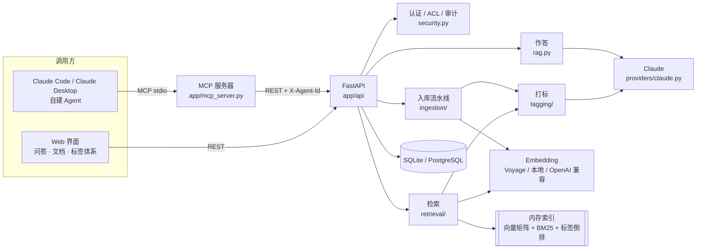
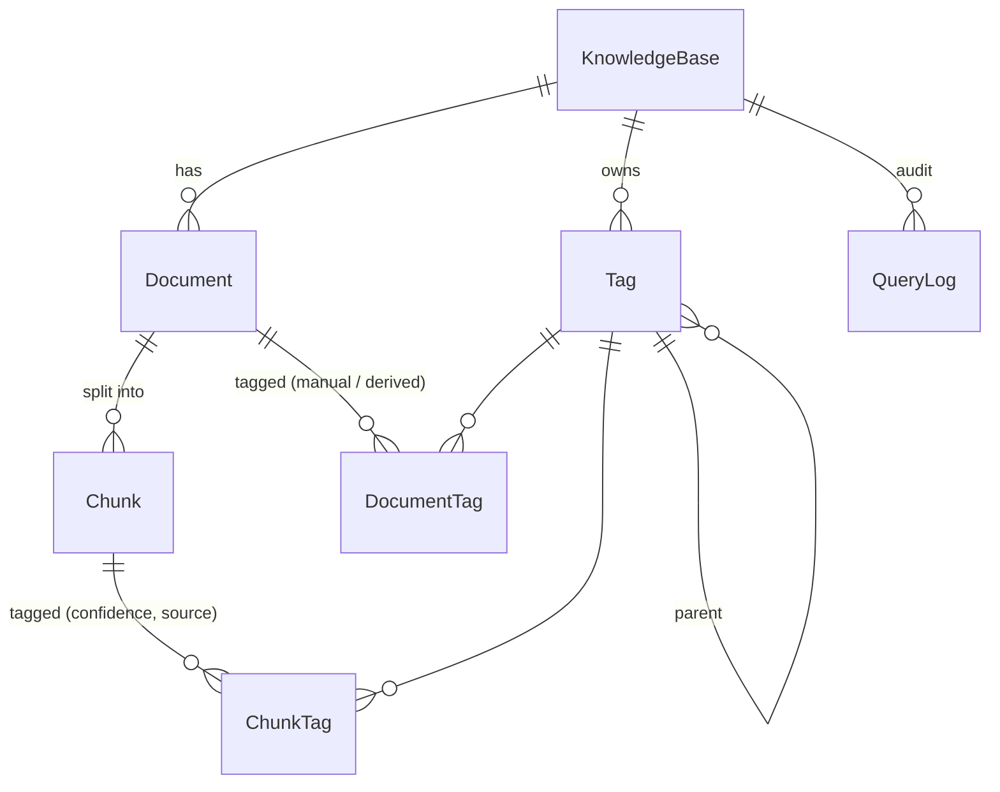
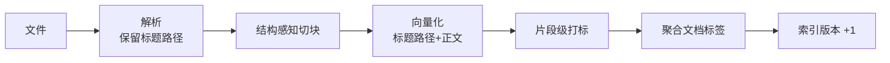
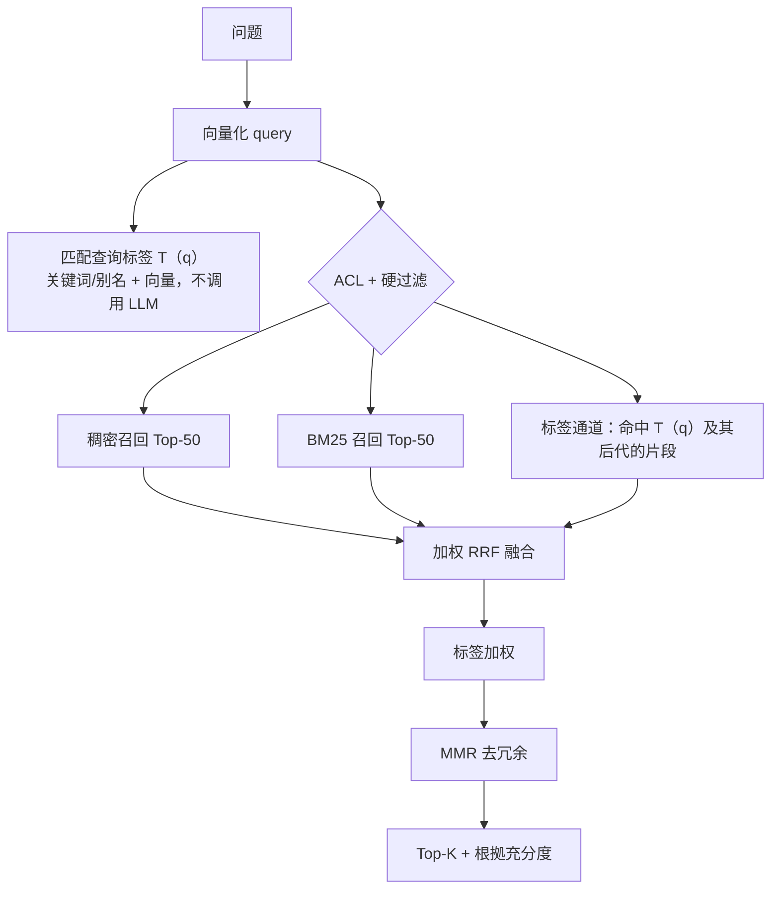

# 架构设计

TagRAG 是一个**给 Agent 用的、受治理的根拠层**（governed evidence layer）。它负责回答三件事：

1. **能用哪些知识**：由人治理的标签体系划定范围，权限在检索之前生效
2. **依据是什么**：每一条结果都带来源文档、章节路径和标签
3. **够不够回答**：每次检索给出根拠充分度，让 Agent 决定继续、谨慎作答还是停止 / 移交

## 总体结构



| 模块 | 路径 | 职责 |
|---|---|---|
| API | `backend/app/api/` | 知识库、文档、标签、检索 / 问答、反馈 |
| 入库 | `backend/app/ingestion/` | 解析 → 结构化切块 → 向量化 → 打标 |
| 标签 | `backend/app/tagging/` | 受控词表、别名、层级、候选审核、合并；片段打标与查询标签匹配 |
| 检索 | `backend/app/retrieval/` | 内存索引、三路召回、融合排序、根拠充分度 |
| 作答 | `backend/app/rag.py` | 带编号引用的生成、拒答、无 LLM 时的降级 |
| 模型 | `backend/app/providers/` | Claude（默认）/ OpenAI 兼容；Voyage / 本地 / OpenAI 兼容 embedding |
| Agent 接口 | `backend/app/mcp_server.py` | MCP 工具，供 Claude 等 Agent 调用 |
| 前端 | `frontend/src/` | React + Ant Design 三个页面 |

## 数据模型



- **Tag**：归属某个知识库。字段包括维度 `facet`（如 topic / department / product）、父标签、别名、状态（`active` / `candidate` / `deprecated`）、被提议次数，以及标签向量。
- **ChunkTag**：标签打在片段级，记录置信度和来源（`llm` / `keyword` / `embedding` / `inherited` / `manual`）。
- **DocumentTag**：文档级标签。`manual` 是人工指定的，会继承到全部片段；`derived` 由片段标签聚合而来。
- **Document**：带内容哈希（同一知识库内去重）和 `acl_groups`（为空表示知识库内公开）。
- **QueryLog**：每次检索 / 问答都记一条：调用者（用户或 `agent:<id>`）、类型（`search` / `chat`）、命中的标签、引用的片段、耗时、反馈。

## 入库流水线



1. **解析**（`parsers.py`）：支持 Markdown、TXT、PDF、Word、HTML、CSV、Excel，统一成带标题路径的段落块。
   - 识别 Markdown 标题、Word 标题样式，以及中文编号标题（第一章、一、（一）、1.1）。
   - 表格按「列名: 值」展开，切块后不会丢掉表头语义。
2. **切块**（`chunker.py`）：
   - 不跨章节；按段落累积，超长段落再按句子切；块与块之间有重叠。
   - 相邻的小章节会合并，标题路径取公共前缀，各自的子标题写进正文。
3. **向量化**：把「标题路径 + 正文」作为 embedding 输入（上下文增强），并区分 document / query 两种类型。
4. **打标**（`tagger.py`）：三路信号合并，每个片段最多保留 `max_tags_per_chunk` 个标签。
   - **关键词**：标签名或别名出现在片段中。名称越长越具体，置信度越高。
   - **向量**：片段向量与标签向量（名称 + 别名 + 说明）的相似度超过阈值。
   - **LLM**：Claude 在受控词表里做多标签分类，用结构化输出保证 JSON 可解析。体系里没有的重要主题可以作为新标签提议，但只进入**候选池**。
   - 人工给文档指定的标签（如部门、密级）继承到全部片段。
5. **文档标签聚合**：覆盖至少 20% 片段，或出现 3 次以上的标签，记为文档的派生标签。
6. 入库在后台线程执行。服务重启后，未完成的文档会继续处理。

## 检索与排序



**权限与硬过滤（召回之前）**

- ACL：片段所属文档的 `acl_groups` 与调用者的用户组没有交集时，直接排除。没有权限的内容永远不会进入 LLM 上下文。
- 硬过滤：用户或 Agent 显式指定的标签会自动展开为「该标签 + 全部后代」。同一维度内取 OR，不同维度之间取 AND。

**三路召回**

- 稠密：query 向量 · 片段向量（向量已归一化，点积即余弦相似度）。
- BM25：中文按单字 + 二元组切词；如果安装了 jieba，额外加入词级 token。
- 标签通道：命中查询标签及其后代的片段，按语义相似度排序。

**融合**

```
rrf(d)   = Σ_通道 w_c / (k + rank_c(d) + 1)        k = 60；w = 1.0（稠密、BM25）/ 0.8（标签）
rel(d)   = rrf(d) / max_rrf                         归一化到 [0, 1]
tag(d)   = max_{q∈T(q), t∈tags(d)} conf_q · conf_t · decay^dist(q, t)
score(d) = rel(d) + tag_boost · tag(d)              tag_boost = 0.35，decay = 0.5
```

- `dist`：同一标签为 0；祖先或后代为相隔层数；兄弟标签为 2；无关标签不计分。
- 设计原则：**标签是软信号**。标签打错只会影响排名，不会让结果变成空。用 `use_tags=false` 可以关掉标签，做 A/B 对比。

**MMR 去冗余**（λ = 0.75）之后取 Top-K，再在 token 预算（默认 3000）内按相关性顺序组装上下文。

**根拠充分度**（启发式，阈值需要用评测集校准）

| 值 | 条件 | Agent 应该怎么做 |
|---|---|---|
| `sufficient` | 第一名片段同时进入稠密和 BM25 的前 3；或命中查询标签（tag ≥ 0.5）并且至少一路排在前 3 | 只依据根拠作答，并标注引用 |
| `weak` | 有结果，但各路信号不一致 | 谨慎表述、引用原文，或者调整范围再检索 |
| `none` | 没有结果 | 不作答，说明知识库中没有依据，或移交给人 |

## 作答

- 系统提示要求：只依据参考资料作答；每条事实标注 `[n]`；资料不足时明确说"没有找到"，不编造；资料之间有冲突时分别引用。
- Claude 调用的参数：
  - 模型 `claude-opus-5-5`，思考由模型自适应；
  - effort：作答 `medium`、打标 `low`；
  - system 带 `cache_control`；
  - 开启服务端拒答兜底（`fallbacks: "default"`），被安全策略拒答时，服务端自动换模型重试；兜底模型也拒答时，返回明确的拒答提示。
- 没有配置 LLM 时，系统降级为抽取式回答：直接返回最相关的原文，标注来源。

## 安全与审计

| 机制 | 说明 |
|---|---|
| API Key | 设置 `TAGRAG_API_KEYS` 后，所有接口都要求 `X-API-Key` |
| 用户身份 | `X-User-Id` / `X-User-Groups` 由网关（SSO）注入，并且必须丢弃客户端自带的值 |
| Agent 身份 | `X-Agent-Id`，审计日志中记为 `agent:<id>`；Agent 的可见范围由它的用户组决定（最小权限） |
| 管理权限 | 只有包含 `admin` 组的调用方可以上传、删除、改标签 |
| 审计 | 每次检索和问答都写入 `query_logs`，可以按调用者、问题、引用来源、反馈追溯 |
| 上传 | 只接受白名单内的扩展名，有大小上限，按内容哈希去重 |

## 规模与扩展

- 当前索引是进程内的 numpy 矩阵 + BM25 倒排，按知识库版本号自动失效重建。单机适合**数十万片段**。
- 规模更大，或需要多实例部署时：
  - 把 `retrieval/index.py` 换成 pgvector、Milvus、Qdrant 或 Elasticsearch；
  - 用 `TAGRAG_DATABASE_URL` 把数据库切到 PostgreSQL；
  - 把入库任务改由 Celery 或 RQ 执行。
- 数据库表由 `create_all` 创建，目前没有迁移工具。升级表结构前请先备份数据，正式上线前建议引入 Alembic。
